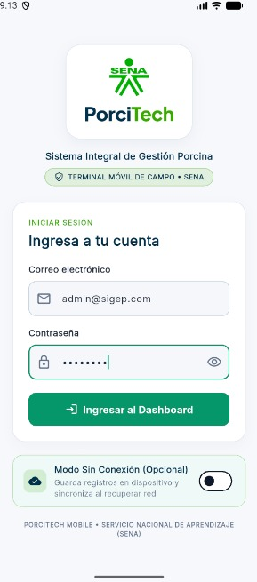
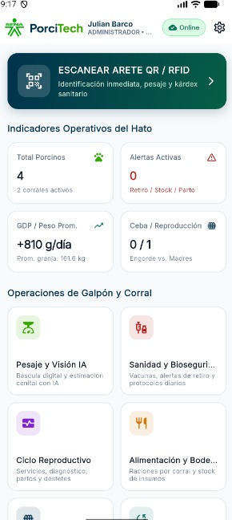
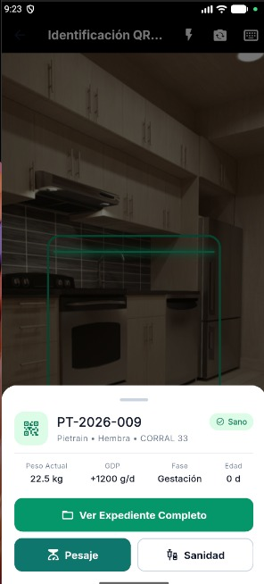
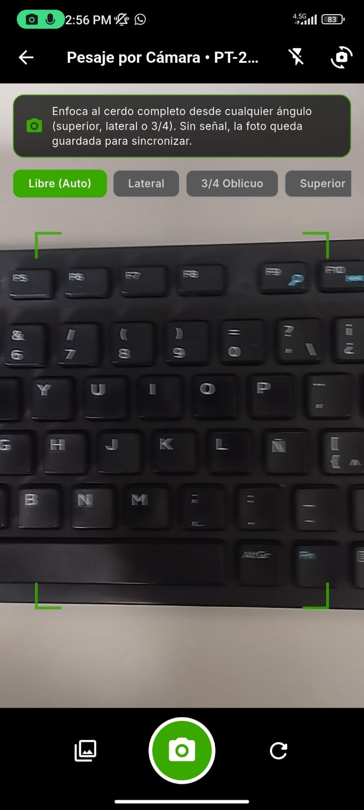
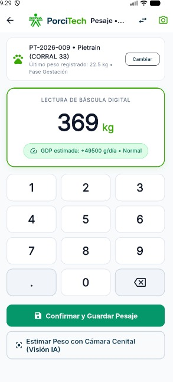
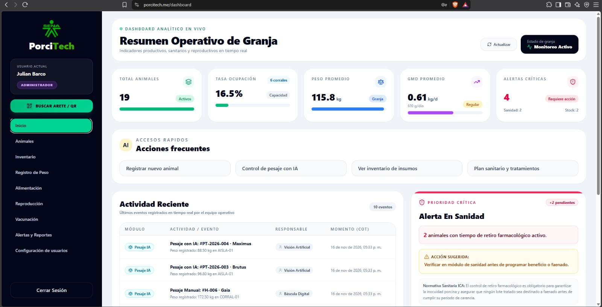

# 📖 MANUAL DE USUARIO
## Plataforma Integral de Gestión Zootécnica, Visión Artificial y Trazabilidad (PorciTech 4.0)

---

### Ficha Metodológica de Documentación (ISO/IEC/IEEE 26514)
* **Programa de Formación:** Tecnólogo en Análisis y Desarrollo de Software (ADSO) — Código 228118
* **Ficha de Caracterización:** 3176243
* **Centro de Formación:** Centro de Teleinformática y Producción Industrial (CTPI) — Regional Cauca
* **Servicio Nacional de Aprendizaje (SENA)**
* **Unidad Productiva Beneficiaria:** Unidad Porcícola del Centro Agropecuario SENA — Granja La Rejoya
* **Alineación Normativa:** **ISO/IEC/IEEE 26514:2022** (*Systems and software engineering — Requirements for designers and developers of user documentation*)
* **Metodología de Gestión Documental:** Docs-as-Code (Markdown versionado en Git)

---

### Matriz de Control de Versiones del Manual (ISO 26514)

| Versión Manual | Versión App | Fecha | Naturaleza de la Actualización | Redactor Técnico | Aprobó |
| :---: | :---: | :---: | :--- | :--- | :--- |
| **v1.0.0** | v1.0.0 | 28/05/2025 | Publicación inicial: Módulos de Login, Catálogo de Cerdos y Aretes QR. | Santiago Avirama | Pablo A. Ortiz (PO) |
| **v2.0.0** | v2.0.0 | 20/07/2025 | Incorporación de la App Móvil: Teclado para guantes y cola Offline-First. | Mariana Guapacha | Pablo A. Ortiz (PO) |
| **v3.0.0** | v3.0.0 | 15/09/2025 | Guía de pesaje cenital por Visión Artificial y Monitor CCTV Dahua. | Juan David Ocampo| Pablo A. Ortiz (PO) |
| **v4.0.0** | v4.0.0 | 09/11/2026 | Consolidación PorciTech 4.0: Pasaporte QR ICA, Kardex y analítica GMD. | Santiago Avirama | Pablo A. Ortiz (PO) |
| **v4.1.0** | v4.1.0 | 18/11/2026 | Actualización integral: Cámara móvil embebida multivista, módulo móvil de alimentación, calibración ArUco web, planes/FCR, auditoría de vacíos sanitarios, alertas de caducidad FEFO, recuperación SMTP y exportación Excel/PDF. | Santiago Avirama | Pablo A. Ortiz (PO) |

---

## ÍNDICE DEL MANUAL DE USUARIO
1. [Introducción y Requisitos del Sistema](#1-introducción-y-requisitos-del-sistema)
2. [Módulo I: Operación Móvil de Campo (App Flutter para Operarios)](#2-módulo-i-operación-móvil-de-campo)
3. [Módulo II: Portal Web Administrativo (Next.js para Administradores y Veterinarios)](#3-módulo-ii-portal-web-administrativo)
4. [Módulo III: Pasaporte Sanitario y Trazabilidad Pública (`/trace/[id]`)](#4-módulo-iii-pasaporte-sanitario)
5. [Módulo IV: Preguntas Frecuentes y Solución de Problemas (FAQ)](#5-módulo-iv-faq)

---

<a name="1-introducción-y-requisitos-del-sistema"></a>
# 1. Introducción y Requisitos del Sistema

### 1.1 ¿Qué es PorciTech 4.0?
**PorciTech 4.0** es un ecosistema tecnológico diseñado para tecnificar la producción porcícola en Colombia. Elimina el estrés del pesaje mecánico mediante **Visión Artificial híbrida (YOLOv8 + XGBoost + calibración ArUco)** capaz de estimar peso desde cámara fija o desde el celular en **cualquier ángulo**, asegura la inocuidad alimentaria controlando los **tiempos de retiro de medicamentos y vencimientos de lotes exigidos por el ICA**, optimiza el 75% del costo de producción mediante **planes nutricionales, cálculo de Conversión Alimenticia (FCR) y Kardex FEFO**, audita **vacíos sanitarios (Todo Adentro / Todo Afuera)** y permite trabajar en galpones **sin conexión a internet** gracias a su arquitectura **Offline-First**.

---

### 1.2 Requisitos para Usuarios Finales

| Entorno de Uso | Dispositivo Recomendado | Conectividad | Requisitos de Software |
| :--- | :--- | :--- | :--- |
| **App Móvil de Campo (`PorciTech-Mobile.apk`)** | Teléfono o tablet Android (versión 8.0 o superior) o iPhone (iOS 13+). | **Funciona 100% Desconectado** en los corrales. Requiere Wi-Fi solo para sincronizar. | Cámara trasera con permisos habilitados para escaneo de QR y captura de peso en vivo. |
| **Portal Web Administrativo** | Computador de escritorio, portátil o tablet. | Red local de la granja (LAN) o internet. | Navegador moderno (Google Chrome, Microsoft Edge, Mozilla Firefox o Safari). |
| **Pasaporte Sanitario QR** | Cualquier smartphone con lector de QR o cámara nativa. | Conexión a red móvil (3G/4G) o Wi-Fi. | Cualquier navegador web (no requiere instalar ninguna app ni iniciar sesión). |

---

### 1.3 Cuentas de Acceso por Rol (Entorno Demostrativo)

Utilice una de las siguientes cuentas según el perfil que desee evaluar:

| Rol | Correo Electrónico | Contraseña | Módulos Habilitados en Web / Móvil |
| :--- | :--- | :---: | :--- |
| **Administrador** | `admin@sigep.com` | `admin123` | Acceso total a los 9 módulos web, exportación oficial Excel/PDF, calibración ArUco y gestión de usuarios. |
| **Médico Veterinario** | `vet@sigep.com` | `vet123` | Inicio, Animales (y Vacíos Sanitarios), Inventario, Reproducción, Vacunación, Alertas/Reportes y Perfil. |
| **Operario de Galpón** | `operario@sigep.com` | `operario123` | Inicio, Animales, Inventario, Registro de Peso, Alimentación y App Móvil completa de campo. |

> [!NOTE]
> Si olvida su contraseña en la plataforma web, puede recuperarla autónomamente haciendo clic en **¿Olvidaste tu contraseña?** en la pantalla de inicio de sesión.

---

<a name="2-módulo-i-operación-móvil-de-campo"></a>
# 📱 2. Módulo I: Operación Móvil de Campo (App Flutter)

Diseñada bajo identidad oficial **SENA PorciTech**, adaptada a humedad, polvo y uso con **guantes de bioseguridad** en los galpones.

---

### 2.1 Pantalla de Bienvenida, Selector de Servidor LAN e Inicio de Sesión

Al abrir la aplicación, se muestra brevemente la pantalla de bienvenida animada con el logotipo oficial **SENA PorciTech** y luego el formulario de acceso.

#### Procedimiento para Configurar la IP del Servidor e Iniciar Sesión:
1. *(Opcional, si usa un computador portátil o servidor nuevo en la finca)* En la pantalla de ingreso, toque el enlace **Conexión con Servidor Local** (muestra la IP actual, ej. `192.168.1.7:8000`).
2. Ingrese la dirección IP y puerto de su servidor en la red Wi-Fi y presione **Guardar IP**.
3. Digite su **Correo Electrónico** y **Contraseña**.
4. Presione el botón verde **Ingresar al Sistema**.
5. La aplicación guardará su sesión de forma cifrada para trabajar en el corral sin pedir credenciales en cada operación.



```text
+-------------------------------------------------------+
|  [LOGO SENA] PORCITECH 4.0 - GESTIÓN DE CAMPO         |
+-------------------------------------------------------+
|  [1] Correo:     [ operario@sigep.com               ] |
|  [2] Contraseña: [ •••••••••••                      ] |
|                                                       |
|  [3] 🌐 Servidor: 192.168.1.7:8000  [ Cambiar IP ]    |
|                                                       |
|        +-------------------------------------+        |
|        | [4] BOTÓN: INGRESAR AL SISTEMA      |        |
|        +-------------------------------------+        |
+-------------------------------------------------------+
```
* **[1] Campo Correo / [2] Contraseña:** Credenciales del operario o veterinario.
* **[3] Selector de Servidor LAN:** Permite cambiar la IP del servidor local sin reinstalar la aplicación.
* **[4] Botón 'Ingresar al Sistema':** Inicia sesión y sincroniza el catálogo real de porcinos, corrales e insumos.

---

### 2.2 Dashboard de Campo y Estado de Conexión



```text
+-------------------------------------------------------+
|  [LOGO] PORCITECH              [1] CHIP: [ Online 🟢 ]|
+-------------------------------------------------------+
|  👤 Juan Perez (Operario de Campo)                    |
|  [2] TARJETA: Corrales Activos: 6  | Total Cerdos: 48 |
+-------------------------------------------------------+
|  ACCIONES RÁPIDAS EN GALPÓN:                          |
|  +------------------------+  +----------------------+ |
|  | [3] 📷 ESCANEAR QR     |  | [4] ⚖️ PESAR CERDO   | |
|  +------------------------+  +----------------------+ |
|  | [5] 🌾 ALIMENTACIÓN    |  | [6] 💉 SANIDAD       | |
|  +------------------------+  +----------------------+ |
|  | [7] 🐷 PARTOS          |  | [8] 📋 LOTES/CORRALES| |
|  +------------------------+  +----------------------+ |
|                                                       |
|  [9] BOTÓN INFERIOR: [ AJUSTES Y COLA OFFLINE ]       |
+-------------------------------------------------------+
```
* **[1] Chip de Conectividad:** `Online 🟢` indica enlace activo con el servidor; `Offline 🟠` indica operación desconectada guardando en cola local.
* **[2] Resumen del Galpón:** Indicadores reales del inventario porcino sincronizado.
* **[3-8] Botones Táctiles Gigantes:** Accesos directos para escanear QR, pesar (manual o cámara IA), registrar raciones de alimento, vacunación, partos y explorar corrales.
* **[9] Ajustes y Cola Offline:** Permite alternar modo offline manual y sincronizar registros pendientes.

---

### 2.3 Escaneo de Arete QR y Consulta Rápida en Corral

#### Procedimiento:
1. En el Dashboard de Campo, presione **Escanear QR** (acepte el permiso de cámara la primera vez).
2. Apunte el visor láser verde hacia el código QR del arete plástico del porcino.
3. El sistema reconoce tanto **códigos QR simples** (ej. `QR-4092`) como **etiquetas impresas con URL completa** (ej. `http://.../trace/QR-4092`).
4. Al leerlo, el teléfono despliega la ficha inmediata del ejemplar desde la parte inferior:



> [!CAUTION]
> **ALERTA DE RETIRO SANITARIO (Semáforo Rojo):**
> Si el porcino escaneado tiene un tratamiento con tiempo de retiro vigente, verá un banner rojo bloqueante indicando el fármaco y los días restantes antes de poder comercializarlo.

---

### 2.4 Estimación de Peso con Cámara Integrada en Vivo (Cualquier Ángulo)

La aplicación integra la cámara directamente en pantalla para pesar porcinos en el corral **sin necesidad de obligar al animal a pararse en una báscula**, soportando fotografías desde **cualquier ángulo**.

#### Procedimiento para Estimar Peso con Cámara IA:
1. Seleccione un porcino desde el escáner QR o desde el selector de animales y toque **Estimar Peso con Cámara IA**.
2. Se abrirá el visor en vivo integrado dentro de la aplicación.
3. Seleccione en la barra superior el ángulo de su toma (por defecto **Libre (Auto)**):
   * **Libre (Auto):** El sistema detecta automáticamente la perspectiva de la foto.
   * **Lateral:** Toma de perfil junto al corral.
   * **3/4 Oblicuo:** Toma en diagonal.
   * **Superior:** Toma cenital desde arriba.
4. *(Opcional)* Use los botones superiores de **Flash**, **Cambiar Cámara** o **Galería** si ya tiene una foto guardada.
5. Encuadre al cerdo completo dentro del visor y presione el botón circular **Capturar**.
6. La imagen se procesa y muestra la silueta segmentada, el peso estimado (kg), el área dorsal ($\text{cm}^2$) y la confianza. Presione **Confirmar y Aplicar Peso** para guardarlo.



```text
+-------------------------------------------------------+
|  CÁMARA DE PESAJE IA          [⚡ Flash] [🖼️ Galería] |
|  Ángulo: [● Libre (Auto)] [ Lateral ] [ 3/4 ] [ Sup.] |
+-------------------------------------------------------+
|                                                       |
|          +-------------------------------+            |
|          |   VISTA EN VIVO DE LA CÁMARA  |            |
|          |    Enfoque el cuerpo completo |            |
|          |         del ejemplar          |            |
|          +-------------------------------+            |
|                                                       |
|                   ( 📷 CAPTURAR )                     |
+-------------------------------------------------------+
```

> [!TIP]
> Aunque la toma desde **cualquier ángulo** aplica corrección geométrica y escala adaptativa automáticamente, procure que el cerdo aparezca completo de cabeza a cola y con buena iluminación para obtener máxima precisión.

---

### 2.5 Registro de Pesaje Manual (Teclado Gigante para Guantes)

Si usa una báscula física de respaldo, ingrese a **Pesar Cerdo > Ingreso Manual** y digite el peso en el teclado numérico táctil de **64 píxeles de altura** con respuesta de vibración háptica (`HapticFeedback`), diseñado para operarse sin quitarse los guantes de bioseguridad.



---

### 2.6 Alimentación y Bodega de Insumos en Campo

Desde el acceso directo **Alimentación** en el Dashboard móvil, el operario cuenta con dos pestañas:

1. **Pestaña `Registrar Ración`:**
   * Seleccione el **Corral** (lote) y el **Alimento** disponible en bodega.
   * Elija la **Fase Nutricional** (`Pre-iniciador`, `Iniciador`, `Levante`, `Ceba`).
   * Digite la **Cantidad (kg)** servida y presione **Registrar Ración**.
   * El sistema descuenta automáticamente los bultos/kg del stock siguiendo el orden de vencimiento **FEFO**.
2. **Pestaña `Stock en Bodega`:**
   * Muestra en tiempo real las existencias de alimentos disponibles en el almacén con indicador de stock mínimo.

---

### 2.7 Registro de Tratamientos Sanitarios y Partos

* **Sanidad / Vacunación:** Seleccione el animal o corral, escoja el medicamento o biológico real del inventario de bodega, ingrese la dosis (botones rápidos `1 ml`, `2 ml`, `3 ml` o manual) y verifique el **lote biológico ICA**. Si algún lote en bodega está vencido, el sistema lo bloqueará automáticamente.
* **Partos en Maternidad:** Seleccione una cerda del hato real (el sistema filtra automáticamente hembras) y use los contadores táctiles `+ / -` para registrar **Nacidos Vivos**, **Nacidos Muertos**, **Momias** y el **Peso Total de la Camada (kg)**.

---

### 2.8 Modo Desconectado y Cola de Sincronización (Offline-First)

1. Cuando pierda conexión Wi-Fi dentro del galpón, el chip superior cambiará a `Offline 🟠`.
2. Sus pesajes manuales, raciones, partos y tratamientos se guardarán en la memoria local con un identificador único (`id_local`).
3. Al volver a la zona con cobertura Wi-Fi, abra el icono de **Ajustes (`⚙️`)** en la esquina superior derecha y presione **Sincronizar Todo Ahora**.
4. Cada registro se envía de forma segura y atómica al servidor; si ocurre un micro-corte durante el envío, el sistema evita duplicados automáticamente.

---

<a name="3-módulo-ii-portal-web-administrativo"></a>
# 💻 3. Módulo II: Portal Web Administrativo (Next.js 16)

Acceso desde cualquier navegador web en:  
👉 `http://localhost:3000` (o la IP LAN del servidor: `http://<IP_SERVIDOR>:3000`).

Al ingresar, la **Landing Page** presenta el resumen del ecosistema y los botones de acceso directo a **Iniciar Sesión** o consultar el portal.

---

### 3.1 Inicio de Sesión, Recuperación SMTP y Navegación Responsiva

#### Cómo Recuperar su Contraseña por Correo:
1. En la pantalla `/login`, haga clic en **¿Olvidaste tu contraseña?**.
2. Ingrese su correo electrónico registrado y presione **Enviar Instrucciones**.
3. Abra su correo y haga clic en el botón **Restablecer mi contraseña** (el enlace caduca automáticamente y es de un solo uso).
4. Ingrese y confirme su nueva contraseña en `/reset-password`.

#### Barra Lateral Adaptable (Escritorio y Móvil):
* En computadores, el menú lateral izquierdo mantiene un tamaño fijo y muestra únicamente los módulos autorizados para su rol.
* En celulares o tablets, presione el **botón de menú (`☰`)** en la barra superior para abrir el cajón de navegación, y use **Búsqueda Rápida QR** para consultar cualquier cerdo por su arete o código QR al instante.

---

### 3.2 Resumen Ejecutivo (Dashboard Central)



Presenta en tiempo real:
* **Tarjetas KPI:** Inventario animal activo, ocupación de corrales, alertas de partos próximos ($\le 7$ días) y retiros farmacológicos activos.
* **Actividad Reciente y Sugerencias:** Últimos movimientos de peso, raciones, sanidad y recomendaciones operativas.

---

### 3.3 Animales, Etiquetas QR y Auditoría de Vacíos Sanitarios

En el menú **Animales** encontrará:
1. **Catálogo de Porcinos y Corrales:** Busque por arete/QR, filtre por corral o estado (`activo`, `lactante`, `gestacion`, `precebo`, `levante`, `engorde`, `cuarentena`, `enfermo`, `reemplazo`, `vendido`, `muerto`, `descarte`).
2. **Hoja de Vida y Etiqueta QR:** Haga clic sobre un animal para ver su genealogía (Padre/Madre), historial de pesajes y generar su etiqueta QR imprimible.
3. **Pestaña Auditoría de Vacíos Sanitarios (Todo Adentro / Todo Afuera):**
   * Permite registrar ciclos sanitarios de lotes por corral (`fecha_entrada`, `fecha_salida`, `dias_vacio_requerido` y confirmación de `desinfección`).
   * El sistema audita automáticamente si entre el lote saliente y el entrante transcurrieron los días mínimos de descanso y marca el estado:
     * 🟢 **Cumple Protocolo**
     * 🔴 **Vacío Insuficiente**
     * 🟡 **Pendiente Desinfección**

---

### 3.4 Pesaje Inteligente: Cámara Dahua en Vivo, Calibración ArUco y Curvas GMD

En el menú **Registro de Peso** dispone de cuatro vistas principales:


1. **Visión Artificial IA (Monitor en Vivo / Subir Foto):**
   * **Monitor en Vivo Dahua:** Visualiza el stream MJPEG continuo sin lag con cambio en caliente entre **Canal 1 (Óptico)** y **Canal 2 (Térmico)**. Seleccione el animal y presione **Capturar y Guardar** para almacenar la lectura.
   * **Subir Foto:** Suba cualquier fotografía del porcino (cenital, oblicua o lateral) y estime el peso con confirmación sonora (*chime*).
   * **Calibración con Marcador ArUco:** En la sección de calibración de la misma tarjeta, suba una fotografía que incluya un marcador físico **ArUco** (por defecto de `10 cm`), presione **Calibrar con ArUco** y el sistema guardará la escala exacta en `px/cm` para todas las futuras mediciones del corral.
2. **Báscula Manual:** Formulario rápido para registrar pesajes de báscula tradicional.
3. **Analítica GMD:** Gráficas de **Ganancia Media Diaria (GMD)** por corral calculadas por TimescaleDB, con **filtro de período** (`7 días`, `15 días`, `30 días`, `90 días`) y comparación frente al estándar Porkcolombia.
4. **Historial de Sesiones:** Tabla cronológica con opción de anulación segura (recalcula automáticamente el último peso válido del animal).

---

### 3.5 Alimentación, Planes Nutricionales y Conversión Alimenticia (FCR)

En el menú **Alimentación** dispone de:
1. **Registro de Raciones y Estado de Silos:** Registra kilogramos suministrados por corral y fase, calculando automáticamente el costo y descontando bultos de bodega por orden FEFO.
2. **Planes de Alimentación por Etapa y Corral:** Cree y administre dietas objetivo (`kg por animal`, `frecuencia diaria`, `FCR objetivo`).
3. **Conversión Alimenticia (FCR):** Tabla comparativa en tiempo real por corral:
   $$\text{FCR} = \frac{\text{Alimento Suministrado (kg)}}{\text{Ganancia de Peso Real (kg)}}$$
   Clasifica automáticamente el corral como **Óptimo**, **Atención** o **Fuera de Estándar** frente a la meta Porkcolombia.

---

### 3.6 Inventario, Kardex FEFO y Alertas de Vencimiento

En el menú **Inventario**:
* **Banner de Lotes Vencidos y Próximos a Vencer:** Destaca en rojo los lotes vencidos y en ámbar los próximos a caducar (dentro de los siguientes 30 días) para priorizar su rotación o retiro.
* **Registro Simplificado de Insumo:** Al presionar **Registrar Nuevo Insumo**, solo el **Nombre**, la **Categoría** y el **Costo Unitario** son obligatorios. Si deja el SKU en blanco, el sistema lo genera automáticamente; además puede ingresar el stock inicial, número de lote, fecha de vencimiento y registro ICA en el mismo paso.
* **Bloqueo Sanitario FEFO:** Al despachar alimento o fármacos, el sistema consume primero el lote vigente más próximo a vencer y **bloquea cualquier intento de usar un lote vencido**.

---

### 3.7 Sanidad, Bioseguridad y Reproducción

* **Vacunación / Sanidad:** Registro de tratamientos y vacunas por animal o corral completo, con selección de lote de bodega, asignación de días de retiro y banner superior de alertas de carencia activas.
* **Bioseguridad:** Checklists diarios operacionales y estructurales exigidos por el ICA (desinfección de vehículos, rodiluvios, control de plagas) con filtro por fecha.
* **Reproducción:** Flujo completo en 3 pestañas: **Servicios** (calcula automáticamente `fecha_probable_parto = fecha_servicio + 114 días`), **Partos** y **Destetes** (calculando días reales de lactancia).

---

### 3.8 Alertas y Reportes Oficiales (Exportación Excel y PDF)

En el menú **Alertas y Reportes**:
1. Seleccione el **Tipo de Reporte** (`Consolidado Integral`, `Producción y Pesos`, `Sanidad y Bioseguridad`, `Reproducción`, `Nutrición`, `Conversión Alimenticia FCR` o `Auditoría de Vacíos Sanitarios`).
2. Defina el **Rango de Fechas** y opcionalmente filtre por **Corral**.
3. Haga clic en:
   * **Generar Vista Previa:** Muestra el informe tabular listo para imprimir.
   * **Descargar Excel (`.xlsx`):** Genera un libro multi-hoja formateado con resumen de KPIs y pestañas detalladas.
   * **Descargar PDF (`.pdf`):** Descarga el documento oficial en formato horizontal listo para auditorías ICA o gerencia.

---

<a name="4-módulo-iii-pasaporte-sanitario"></a>
# 🛡️ 4. Módulo III: Pasaporte Sanitario y Trazabilidad Pública (`/trace/[id]`)

Diseñado para cumplir con las exigencias de inocuidad alimentaria del **ICA e INVIMA** en plantas de beneficio (frigoríficos) o puntos de comercialización.

---

### 4.1 Consulta Pública sin Registro
Al escanear el código QR del arete con cualquier cámara de teléfono, se abre automáticamente la ruta pública `http://<servidor>:3000/trace/<codigo_qr>` sin solicitar usuario ni contraseña. La página consulta en tiempo real los tratamientos clínicos registrados para ese animal y evalúa sus días de retiro vigentes:

#### Caso A: Animal Apto (Certificado Verde)
* `🟢 APTO PARA COMERCIALIZACIÓN Y BENEFICIO`: Muestra 0 días de retiro activos, historial de biológicos certificados (con fecha de aplicación, número de lote y médico veterinario responsable) y genealogía.

#### Caso B: Animal en Carencia Farmacológica (Bloqueo Rojo)
* `🔴 PERIODO DE CARENCIA ACTIVO — NO APTO PARA SACRIFICIO`: Indica el medicamento aplicado, la fecha de aplicación, los **días exactos faltantes** y la fecha futura en la cual quedará liberado para beneficio.

---

<a name="5-módulo-iv-faq"></a>
# ❓ 5. Módulo IV: Preguntas Frecuentes y Solución de Problemas (FAQ)

### P1: "¿Qué debo hacer si la app móvil muestra el chip en color ÁMBAR (Offline)?"
* **Respuesta:** Siga trabajando con normalidad. Sus pesajes manuales, raciones, vacunas y partos se almacenan en la cola local del teléfono. Al regresar a la zona con Wi-Fi, abra **Ajustes (`⚙️`)** y presione **Sincronizar Todo Ahora**.

### P2: "¿Puedo tomar la foto de pesaje IA desde un lado (perfil) si no puedo subirme encima del corral?"
* **Respuesta:** **Sí.** En la cámara integrada de la app móvil seleccione el ángulo **Libre (Auto)**, **Lateral** o **3/4 Oblicuo** según su posición, asegúrese de que el cerdo aparezca completo dentro del encuadre y capture la foto.

### P3: "¿Cómo conecto la app móvil si cambió la IP del computador servidor en la granja?"
* **Respuesta:** En la pantalla de **Inicio de Sesión** de la app móvil, toque **Conexión con Servidor Local**, escriba la nueva IP con `:8000` (por ejemplo `192.168.1.25:8000`) y presione **Guardar IP**.

### P4: "¿Por qué el sistema no me deja registrar un tratamiento o ración usando cierto lote de bodega?"
* **Respuesta:** Por normativa sanitaria del ICA, PorciTech **bloquea automáticamente cualquier lote cuya fecha de vencimiento ya haya expirado**. Registre un nuevo lote vigente en **Inventario** o utilice otro lote disponible.

### P5: "¿Por qué la Auditoría de Vacíos Sanitarios muestra 'Vacío Insuficiente'?"
* **Respuesta:** Indica que entre la fecha de salida del lote anterior y la fecha de entrada del nuevo lote en ese corral transcurrieron menos días que el mínimo requerido (`dias_vacio_requerido`, por defecto 7 días) o aún falta verificar la desinfección.

---

<a name="6-matriz-de-control-de-versiones"></a>
# 📋 6. Matriz de Aprobación Documental (SENA ADSO)

* **Ubicación en Repositorio:** [`MANUAL_DE_USUARIO.md`](file:///home/santiago/Documentos/ADSO_SENA_3176243/CODIGO_FUENTE_PORCITECH/MANUAL_DE_USUARIO.md)
* **Directorio de Activos:** [`docs/assets/screenshots/`](file:///home/santiago/Documentos/ADSO_SENA_3176243/CODIGO_FUENTE_PORCITECH/docs/assets/screenshots)
* **Alineación:** Estándar ISO/IEC/IEEE 26514:2022 y Competencias SENA 220501095, 220501097 y 220501098.
